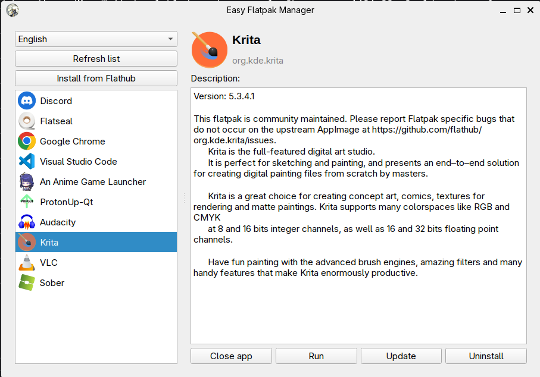

# Easy FLATPAK manager
Easy flatpak manager - this is a program that allows you to easily and simply use flatpak on Linux systems.

The goal of the project is to help those who have just discovered Linux and are not accustomed to using the terminal.
###### Screenshot

### Requirements
- Linux
- Installed flatpak with [flathub](https://flathub.org/en/setup)
- Python 3.8+
### How to use
Quick Start:
```bash
git clone https://github.com/Kermelycka/easy-flatpak-manager.git
```
```bash
cd easy-flatpak-manager
```
```bash
pip install -r requirements.txt
```
After this, your system will be ready and you can run the program itself:
```bash
python3 run.py
```
If you need to run the program again, you need to go to the repository folder:
```bash
cd easy-flatpak-manager
```
Then run the program itself through python:
```bash
python3 run.py
```
